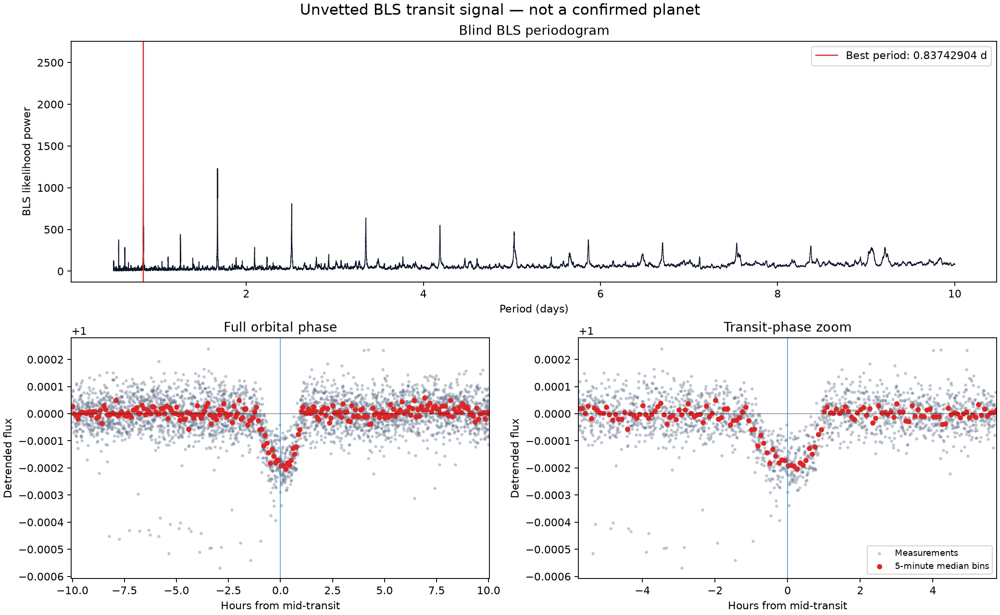
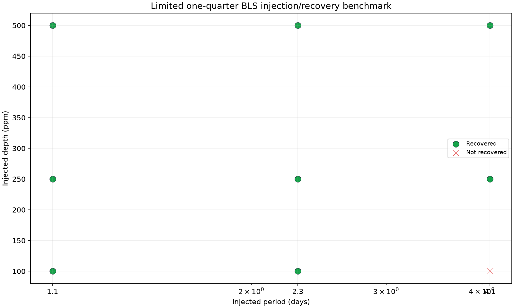

# TransitHunter

[](https://github.com/Taibi1234/TransitHunter/actions/workflows/ci.yml)

TransitHunter is a reproducible Python research pipeline for blind searches for
periodic transit-like signals in real Kepler light curves. It combines MAST
light-curve acquisition, conservative preprocessing, transit-aware detrending,
Box Least Squares (BLS), candidate screening, NASA catalogue cross-matching,
and controlled injection/recovery experiments.

The project is designed around scientific provenance and explicit uncertainty:
every stage produces machine-readable reports, source hashes, diagnostic
figures, and processing parameters.

## Scientific scope

TransitHunter identifies **transit-like signals and planet candidates**. It
does not independently confirm planets or establish new discoveries.

- A catalogue period match identifies an already known signal.
- No catalogue match does not prove that a signal is new.
- Formal BLS significance assumes measurement uncertainties and does not fully
  account for correlated stellar or instrumental noise.
- Odd/even and secondary-eclipse checks are screening tests, not confirmation.

## Current capabilities

- Real Kepler light-curve acquisition from MAST through Lightkurve.
- Query-specific deterministic caching with archive provenance.
- Original quality flags retained in raw exports.
- Quality filtering, finite-value checks, and median normalization.
- Positive-only outlier clipping so transit-like dips are not sigma-clipped.
- Gap-aware rolling-median detrending with negative-deviation protection.
- Blind BLS searches over period, duration, and epoch.
- Phase-folded and periodogram diagnostics.
- Individual primary-transit and secondary-phase depth measurements.
- Odd/even depth comparison and phase-0.5 secondary screening.
- Exact-KIC cross-matching against cumulative KOI and confirmed-planet tables.
- Zero-depth controls and bounded injection/recovery experiments.
- One end-to-end command with a JSON run manifest.

## Validation: blind recovery of Kepler-10 b

The validation target was **KIC 11904151, Kepler Quarter 3**. No published
planetary period or epoch was supplied to the preprocessing or search stages.

| Measurement | Result |
|---|---:|
| Downloaded rows | 4,228 |
| Rows after conservative preprocessing | 3,633 |
| Detrended observing segments | 4 |
| Blind BLS period | 0.8374290408 d |
| NASA KOI period | 0.837491225 d |
| Approximate period difference | 5.37 seconds |
| BLS depth | 151.33 ppm |
| Selected duration | 1.92 hours |
| Odd/even difference | -1.878 formal sigma |
| Phase-0.5 secondary measurement | 7.69 ppm, formal SNR 3.126 |
| Catalogue identification | Kepler-10 b / K00072.01 |

The small secondary measurement remains flagged for review. It is not, by
itself, evidence of an eclipsing binary or a confirmed planetary occultation.



This is a **known-planet re-detection benchmark**, not a new discovery.

## Limited injection/recovery benchmark

Nine deterministic box-shaped signals were injected into the detrended real
light curve after masking the strongest blindly recovered known signal. Only
the strongest BLS peak from each trial was evaluated.

| Injected depth | Recovered |
|---:|---:|
| 100 ppm | 2 / 3 |
| 250 ppm | 3 / 3 |
| 500 ppm | 3 / 3 |
| **Total** | **8 / 9** |

The zero-depth control produced a residual 141 ppm signal at 9.07 days with
formal depth SNR 25. This demonstrates why a large formal BLS SNR is not
sufficient evidence for a real astrophysical signal.



These results describe one implementation, target, quarter, and trial grid.
They are **not** a mission-wide or general real-world performance estimate.

## Installation

Requires Python 3.11–3.13. The documented commands use Windows PowerShell.

```powershell
git clone https://github.com/Taibi1234/TransitHunter.git
cd TransitHunter
py -3.11 -m venv .venv
.\.venv\Scripts\python.exe -m pip install --upgrade pip
.\.venv\Scripts\python.exe -m pip install -e ".[dev]"
.\.venv\Scripts\python.exe -m pytest -q